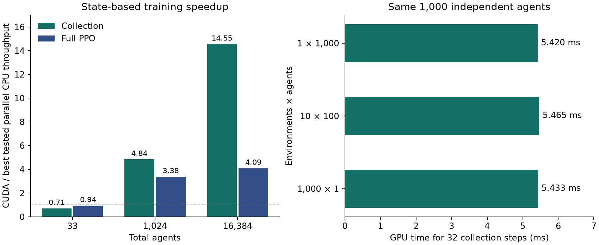

# Flightmare CUDA

Flightmare CUDA advances batches of quadrotors on an NVIDIA GPU. A PyTorch policy can read observations, write actions, step physics, compute rewards and reset selected agents on device. Use the same simulator with a single aircraft to exercise PX4's estimator and actuator loop. The current source version is **0.2.0**.

This project derives its quadrotor equations and reference task from UZH RPG Flightmare. The CUDA runtime, tensor interfaces, collision queries and sensor scheduling are developed here. The original CPU implementation remains available in the same checkout for legacy applications and numerical comparisons. [Upstream project and citation](#upstream-attribution)

## Build and run your first batch

The supported 0.2.0 install builds from source. To get the CUDA branch explicitly, run

```sh
git clone --branch main https://github.com/andrew-olvera-research/flightmare-CUDA.git
cd flightmare-CUDA
```

Start from the repository root with Docker Compose and an NVIDIA GPU accessible to Linux containers. The development image supplies CUDA and the C++ build tools. The reference machine uses an RTX 5070 Ti. For a different GPU, set `FLIGHTMARE_CUDA_ARCHITECTURES=native` in the root `.env` before starting Compose.

```sh
docker compose up -d --build dev
docker compose exec -T dev bash scripts/setup-cuda-python.sh
docker compose exec -T dev python3 scripts/local_ci.py verify
```

The last command builds the CPU reference and CUDA packages, compares their trajectories and runs examples from a fresh install. To keep the packages available for your own scripts inside the dev container, run

```sh
docker compose exec -T dev cmake --install /build/flightlib-cuda-python-native --prefix /build/flightmare-install
docker compose exec -T dev /build/flightlib-cuda-python/bin/pip install --no-deps --no-build-isolation ./flightrl-cuda
docker compose exec -T -e PYTHONPATH=/build/flightmare-install dev /build/flightlib-cuda-python/bin/python -m flightrl_cuda.custom_collector
```

The example prints `Collected 24 valid transitions, including a same-step reset.` It runs a PyTorch policy on six agents and retains both the terminal observation and the next policy input. [Collector source](flightrl-cuda/flightrl_cuda/custom_collector.py)

## Choose an interface

| To do this | Start here |
| --- | --- |
| Advance dynamics with your own controller, task or reward | [Core Python example](flightlib-cuda/python/examples/core.py) · [C++ consumer](flightlib-cuda/examples/native/main.cpp) |
| Train on the stock quadrotor task with your own network and optimizer | [TensorEnv collector](flightrl-cuda/flightrl_cuda/custom_collector.py) · [API and reset semantics](flightlib-cuda/docs/cuda9-usage-contract.md) |
| Check floor and gate contact or enable moving-agent collisions within one world | [Course rollout](flightrl-cuda/flightrl_cuda/course_rollout.py) · [Static geometry](flightlib-cuda/docs/cuda11-static-collision.md) · [Swarm contact](flightlib-cuda/docs/cuda12-swarm-collision.md) |
| Read simulated IMU, odometry or absolute pressure | [Sensor configuration and hardware comparisons](flightlib-cuda/docs/cuda13-sensors.md) · [Sensor example](flightrl-cuda/flightrl_cuda/sensor_example.py) |
| Capture a rollout on a caller-owned stream or export selected measurements | [Python stream and graph API](flightlib-cuda/python/README.md) · [Bounded subscriptions](flightlib-cuda/docs/cuda14-transport.md) |
| Render FPV RGB or depth from supported Unity or USD scene assets | [In-process Newton tiled camera, asset support and examples](tools/newton/README.md) |
| Validate flight software on one aircraft | [ROS 2 Jazzy clock, sensor and camera topics](tools/ros2/README.md) · [PX4 SITL setup and estimator qualification](tools/px4/README.md) |

A batch has `environments × slots` agents. Slots in one environment can interact when agent collisions are enabled. Simulation outputs borrow device storage that the next step can overwrite. Copy observations into your rollout buffer if you need them for a later update. [Tensor layouts and ownership](flightlib-cuda/python/README.md)

For state-based robustness experiments, transform the borrowed observation into a separate policy input on the caller's CUDA stream. Apply your own bias, noise or delayed-observation model there to preserve ground truth for rewards and estimator scoring. When a consumer needs sampling times, mounts, dropout and delivery delay, use the scheduled sensor packets. Cameras produce RGB and optional forward depth from the same scene. [Sensor example](flightrl-cuda/flightrl_cuda/sensor_example.py) · [Camera graph example](tools/newton/README.md#capture-and-replay)

## What parity covers

The `verify` profile sends matched inputs through the frozen Flightlib CPU implementation and CUDA. It checks model setup, state and motor trajectories, command modes, integration schedules, bounds, observations, rewards and terminal/reset behavior. Comparisons use field-specific tolerances. A separate optimized CPU comparison exercises differences introduced by vectorized arithmetic. GPU random resets have their own reproducibility tests. [Numerical budgets and exclusions](flightlib-cuda/docs/flightlib-support.md) · [Core method mapping](flightlib-cuda/docs/core-api.md)

Collision geometry, sensor models, tiled camera output and ROS 2/PX4 timing have separate fixtures and qualification procedures. The supported geometry subset, sensor error assumptions and single-aircraft SITL configuration are documented in the corresponding guides above. [Development and release checks](docs/local-development.md)

## Reference performance

On an RTX 5070 Ti and Ryzen 7 9800X3D, a matched state-based rollout, GAE and two PPO epochs achieved about **3.4× the throughput at 1,024 agents** and **4.1× at 16,384 agents** relative to the best parallel CPU configuration tested. The CPU was faster at 33 agents. Camera rendering and PX4 have their own workload and timings. [Benchmark configuration and results](flightlib-cuda/docs/cuda9-validation.md) · [FPV measurements](tools/newton/README.md) · [PX4 measurements](tools/px4/README.md)



At a fixed 1,000 independent aircraft, 32 collection steps took **5.420 ms** in one environment and **5.433 ms** across 1,000 environments. The GPU advances individual aircraft in parallel in either layout. Interactions add work within each world. In a separate 1,000-aircraft formation, a 10 ms physics tick took **17.93 µs** with collision queries disabled and **189.04 µs** with both course and peer checks enabled. The formation timings measure a whole physics tick. The grouping timings include policy collection. [Grouping measurements](flightlib-cuda/docs/v0.1.1-scaling.md) · [Interacting formation](flightlib-cuda/docs/cuda12-swarm-collision.md)

For collision-enabled Split-S with one aircraft per environment and the same GPU learner, the 100.7M-transition run at 131,072 environments reached **53.33M vs 4.31M transitions/s** during collection and **8.07M vs 2.75M** across the full PPO iteration (CUDA vs 16-thread CPU). [Protocol and per-rollout results](flightlib-cuda/docs/cuda15-ppo-comparison.md)

## Future work and contributions

- **Neighbor observations and communication.** A useful first contribution would expose timestamped relative neighbor state with bounded storage, then model delay and packet loss on device. Test world isolation and reset handling and report candidate counts in sparse and dense formations.
- **Replayable swarm encounters.** Drive one PX4-controlled aircraft alongside recorded peers. Compare estimator error and closest approach against a deterministic replay, and report simulated peers and live flight stacks separately.
- **Sensor error models.** Contribute a batched measurement model with units, frames and sample timing, an openly reproducible recording, and held-out residuals. Pressure response during climbs is one open measurement.
- **Multi-aircraft vision.** Render selected ego cameras in a shared world, verify peer visibility and occlusion at known poses, then sweep camera count independently of aircraft count.

Include a runnable example and the smallest fixture that verifies the new behavior. For performance changes, report the GPU, world and aircraft counts, enabled interactions and what the timing includes. [Local validation](docs/local-development.md) · [Open issues](https://github.com/andrew-olvera-research/flightmare-CUDA/issues)

## Upstream attribution

This project builds on [UZH RPG Flightmare](https://github.com/uzh-rpg/flightmare).
The original source and frozen CPU behavior oracle are retained. The upstream
Unity features are described in the [original documentation](https://flightmare.readthedocs.io/).
Please retain the MIT [license](LICENSE) and cite the original work:

```bibtex
@inproceedings{song2020flightmare,
  title={Flightmare: A Flexible Quadrotor Simulator},
  author={Song, Yunlong and Naji, Selim and Kaufmann, Elia and Loquercio, Antonio and Scaramuzza, Davide},
  booktitle={Conference on Robot Learning},
  year={2020}
}
```
