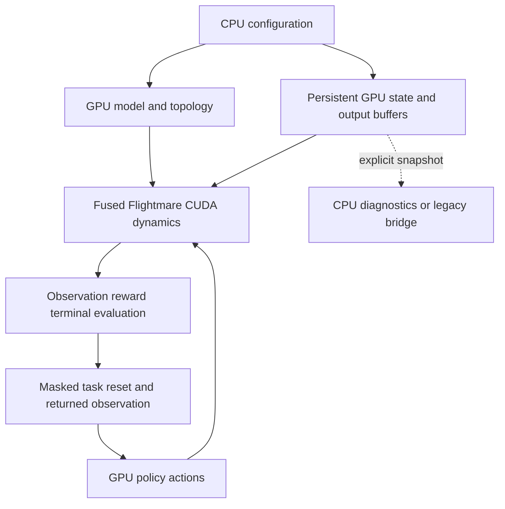

# Flightlib CUDA contracts and implementation architecture

Status: version 1 data contract frozen for implementation. Kernel partitioning
below is the initial design and may change through profiling without changing
the contract. CUDA-2 implements persistent storage, binding validation, stream
ordering, and ownership. CUDA-3 adds model preparation and low-level state and
command lifecycle operations. CUDA-4 adds fused dynamics. CUDA-5 adds native
environment stepping, task outputs and episode resets. CUDA-6 adds resident
PyTorch bindings, explicit graph replay and GPU policy stream handoffs.
Geometry is deferred to a separate future extension.

Post-CUDA-6 review: the [parallel CPU baseline](cpu-parallel-performance.md)
supports retaining the resident/fused architecture. The current milestone is
reproduction of the scoped Flightlib core, not new geometry or an RL framework.
The [current scope and remaining layers](flightlib-scope.md) supersede the earlier
[collision-first proposal](cuda7-collision-plan.md) and the historical geometry
implementation sequence below. CUDA-7 completes state/numerical parity; CUDA-8
completes the resident core API/package; CUDA-9 qualifies that package. Rendering,
sensor/scene fidelity, collision detection and the RL wrapper are later work.
Frozen geometry declarations remain reserved future interfaces, not current
implementation requirements. Existing task and Python Environment APIs remain
supported without expanding their RL scope.

The authoritative declarations are
[contracts.hpp](../include/flightlib_cuda/contracts.hpp). This document defines
their semantics. Changes to field meaning, dtype, tensor shape, indexing,
ordering, or lifecycle require a new contract version and migration notes.
These C++ structures are not an on-disk or cross-compiler binary ABI. Raw
descriptors contain pointers and must never be serialized.

## Scope and architecture

Preserve Flightmare's scoped quadrotor dynamics, controller, motor model,
integrator, environment behavior, and legacy quirks. There is no PhysX or
replacement physics engine. Geometry queries report results; they do not apply
impulses or replace the legacy world-box operation. Sensors/rendering and new
platform dynamics are separate extensions, not implicit functionality in v1.



CPU work is configuration, shape validation, parameter preparation, resource
creation, and asynchronous launch orchestration. Device memory is authoritative
after upload. The Simulation owner holds allocations and streams;
descriptors are cheap non-owning views, not per-drone objects. No Eigen, Torch,
Warp, CUDA runtime, or renderer dependency is required to include the contracts.

## Dimensions and indexing

| Symbol | Meaning |
| --- | --- |
| E | Positive environment capacity |
| A | Positive quadrotor slots per environment |
| N | E times A; lane n = e times A + a |
| P | Positive model/parameter table capacity |
| S | Number of integration substeps for one control interval |
| I | Geometry instance capacity |
| Q | Ray query capacity |
| K | Broad-phase candidate capacity per environment |

N must be below UINT32_MAX, which is the invalid index sentinel. All element
offsets, products, and byte calculations use 64-bit arithmetic, with allocation
overflow checked before allocation. Slots remain stable for the lifetime of a
simulation. An inactive slot is retained, never compacted or renumbered.
Different dynamics models will get separate typed pools; v1 is a quadrotor pool
and does not claim to simulate arbitrary platforms.

TensorView is dense row-major without hidden padding. Every descriptor's shape
must match this document. An API wrapper must validate dimensions, device,
capacity, aliasing, and dtype before enqueueing any mutations. Descriptors do
not validate these properties themselves. Device kernels do not bounds-check
each element; they must guard the lane/query index at their entry.

Internal physics is component-major [C,N]. Logical [E,A,C] access has element
strides [A,1,N]; this is an external strided alias, not a dense TensorView.
Policy input/output is dense [E,A,C], strides [A*C,C,1]. Construct observations
directly in that layout. Packing an entire state each step is forbidden unless
explicitly requested by a consumer and included in the performance budget.

For A=1 the compatibility adapter can squeeze the slot dimension without a
copy. For A>1 v1 supplies independent per-platform task results. Shared reward,
environment-wide done, group reset, and inter-platform forces are not defined.
They require an explicit task extension rather than an accidental any/all
reduction. Geometry is isolated by environment ID even if coordinates overlap.

## State schema and units

All physical values are IEEE float32; masks are uint8 values 0 or 1; IDs are
uint32; episode and random counters are uint64. Coordinates are right-handed
and local to an environment's world. Gravity is along negative Z in the default
Flightmare configuration. Position/linear velocity/linear acceleration are
world quantities in m, m/s, m/s squared; angular velocity and torque are body
quantities in rad/s and N m. Quaternion wxyz maps body vectors to world vectors.
Environment display offsets never enter dynamics or query coordinates.

| Buffer | Shape | Meaning |
| --- | --- | --- |
| state.x | [25,N] | Legacy state fields below |
| state.time | [N] | Simulation seconds, float32 |
| state.motor_omega | [4,N] | Rotor speed in rad/s, legacy rotor order |
| state.motor_thrust | [4,N] | Rotor force in N, same order |
| accepted command mode/time/payload | [N], [N], [4,N] | Persistent last accepted command |
| topology.model_id / active | [N] each | Model lookup and lifecycle mask |
| topology.world_bounds | [6,N] | xmin,xmax,ymin,ymax,zmin,zmax |
| diagnostics.status | [N] | Status of most recent submitted operation |

| state.x rows | Meaning |
| --- | --- |
| 0..2 | Position xyz |
| 3..6 | Quaternion wxyz |
| 7..9 | World linear velocity xyz |
| 10..12 | Body angular velocity xyz |
| 13..15 | World linear acceleration xyz |
| 16..18 | Body torque xyz |
| 19..21 | Legacy angular bias xyz |
| 22..24 | Legacy acceleration bias xyz |

The single [25,N] allocation is a structure of arrays: row groups are views,
not copies. Preserve auxiliary fields even where derivatives are zero. Do not
silently normalize state during import or reset. A supplied valid legacy state
need not have unit quaternion norm. Rotor state resets to zero even though the
model's commanded motor-speed lower bound is positive.

CommandMode RotorThrust payload is [f0,f1,f2,f3] in N.
CollectiveBodyRates payload is [collective,wx,wy,wz], where collective is
mass-normalized acceleration in m/s squared. Mode and all active payload values
and time must be valid. A legacy adapter must perform the original XOR validity
check on the NaN-based command fields before constructing this typed command;
it must reject ambiguous commands rather than choose a mode. Accepted commands
are clamped in the legacy order and retained until replaced. Command time and
simulation time are independent.

## Model and task parameters

QuadModelView stores SoA columns indexed by model_id. A shared model has one
column; per-lane randomization can use P=N. Inertia and its inverse are diagonal
[3,P]. Allocation/inverse allocation are [16,P], flattened row-major. Thrust
polynomial coefficients are quadratic, linear, constant. Every remaining shape
is declared in the header. Derive these values on the host using the legacy
configuration behavior, then upload. In particular preserve the cached legacy
thrust cap when YAML changes motor-speed limits; do not recompute it as a fix.
The actual prepared table is the contract, not a new parameter derivation model.

Parameters and topology are immutable during a submitted step. Updates occur
at an explicit stream-ordered boundary, with dependent constants prepared
together. World bounds are per lane. No per-lane heap allocations or matrix
inversions are allowed in the stepping path.

Task action_mean/scale are [4,N], goal is [12,N], reward coefficients are [5,N]
in position, orientation, velocity, rates, raw-action order. The legacy task
uses survival reward +0.1, terminal altitude <=0.02, terminal adjustment -0.02,
and raw action L2 norm rather than squared norm. max_t is compatibility metadata
for episode-length reporting; it does not automatically terminate this task.

| Task buffer | Shape | Semantics |
| --- | --- | --- |
| input.action | [E,A,4] | Raw actions, not clipped policy outputs |
| output.observation | [E,A,12] | Returned observation; reset observation if done |
| output.transition_observation | [E,A,12] | Post-step observation before reset, every lane |
| output.reward | [E,A] | Transition reward including terminal adjustment |
| output.done | [E,A] | Terminal flag before reset |
| output.valid | [E,A] | Whether this transition may be consumed |

Observation order is position xyz, Eigen's legacy Euler angles ZYX, linear
velocity xyz, body rates xyz. Preserve Euler branch behavior, not just the
represented rotation. Transition observation always exists so reset cannot
destroy the transition needed by training. No automatic reset may overwrite
reward or done. For inactive lanes outputs are zero and valid=0. For failed
lanes outputs are zero and valid=0, with diagnostics explaining failure; this
is the tensor API's explicit failure contract, not a claim that legacy Env::step
has identical invalid-input behavior. Valid legacy inputs retain parity.

EpisodeState stores per-lane episode number, step number, RNG key/counter, and
the task's independent command clock. A successful task reset increments episode,
zeros step and command_time, resets the task command to zero rotor thrust, and
does not rewind its random counter. Initial counters start at zero; the initial
task reset starts episode 1. Low-level Quadrotor reset restores supplied x/time
and zeros motors; it does not change the accepted command or task counters.
Invalid resets leave state and motors unchanged. A low-level state setter will
be distinct from reset because setState preserves motors.

ResetInput contains explicit per-lane state/time and a selection mask. Only
selected active lanes are read. Device RNG will generate the same format for
automatic task resets. RNG algorithm and bitwise CPU RNG reproduction are not
frozen: parity uses identical explicit reset samples; production RNG must be
reproducible per lane and independent of scheduling. Requiring exact CPU random
sequences would be a separate compatibility feature.

## Ownership and synchronization

Before first use, initialize every active lane through an explicit reset. Zero
state means x=0 with quaternion w=1, time=0, and both motor arrays zero. Command
storage starts Invalid until setCommand or a task reset installs a valid command.
Inactive lanes use the same finite neutral state; kernels skip them and write
Inactive diagnostics. Task outputs and episode counters start at zero. RNG keys
are initialized from the configured seed and stable lane ID, never allocation
address. Query outputs start Inactive with the sentinels described below.
Unused candidate slots are unspecified and must never be read past count.

Zero-capacity optional geometry/query buffers may have null pointers. Required
buffers for enabled operations must be non-null even if every lane is inactive.
No step may consume a default-constructed descriptor. TensorView::size/offset
are unchecked arithmetic helpers for validated shapes; the future binding layer
must reject arbitrary overflowing external shapes before invoking them.

The Simulation owner keeps allocations alive until all queued consumers finish.
Views do not own memory. Tensor framework adapters must retain the owner and
honor producer/consumer stream events. Device pointer, dtype, shape, stride,
device ordinal, and lifetime are all part of interop validation. No adapter
may silently call contiguous(), transfer devices, or synchronize to repair input.

Use one simulation stream initially; accept an external compatible stream or
explicit event dependencies. Input buffers remain unchanged until their work
finishes. State/output views are borrowed and overwritten by subsequent steps;
rollout history needs caller-owned device storage. Concurrent steps on the same
simulation are forbidden. Read-only rendering needs an event-protected snapshot
or a double buffer so it cannot race the next state write.

State, command storage, reset input, raw actions, model tables, and outputs must
not alias each other. This is essential for masked updates and raw-action reward
parity. Component views within state.x are the intentional exception. Device
errors are reported in device status arrays without a host read during step.
Host shape errors reject the entire call before enqueueing any work.

## Kernel stages and data flow

The initial parallel unit is one lane/thread for dynamics and one ray/thread
for queries. Blocks span lanes. This is a measured starting point, not a frozen
block size or occupancy claim. The first kernels should avoid fast-math and
preserve expression ordering until differential tests establish tolerances.

| Stage | Reads | Writes | Fusion and ordering |
| --- | --- | --- | --- |
| D dynamics | State, accepted/input commands or raw actions, model, topology, schedule | State, accepted command, lane status, task command clock when applicable | Fuse command validation/clamps, controller, motor update, RK4, all substeps, world box |
| T task evaluation | Post-D state, raw actions, goals, coefficients, status | Both observations, reward, done, valid | Fuse observation, reward, terminal calculation; can fuse into D after profiling |
| R task reset | Done/valid, reset samples or RNG, active mask | Selected state/motors/commands, counters, returned observation | Runs after T; never destroys transition observation/reward/done |
| G geometry update | Post-D state, instance local transforms | World instance poses and AABBs | Before queries; reads pre-reset state |
| Q queries | Instance poses/assets, ray requests or AABBs | Ray outputs, candidate pairs, confirmed overlap flags | Separate irregular workload; no feedback to dynamics in v1 |

With queries enabled the initial order is D -> G -> Q -> T -> R. This makes
geometry results describe the completed transition, before reset. They remain
valid until the next query call. An explicit query of the returned reset state
must update geometry again; it is a separate operation. Geometry results do not
change the legacy task's reward or terminal test. With queries disabled omit G/Q.

Within D, keep mutable state and useful RK4 intermediates local to the thread.
There are no global k1/k2/k3/k4 tensors in the contract. Retain the control-step
starting position for world-box rollback. Derivatives of acceleration/torque
and bias fields remain zero; acceleration and torque are updated before each
RK4 invocation. Preserve the ineffective quaternion normalization ordering in
the original run method. World-box constraints execute once per control call,
not per substep. Time adds control_dt once per call.

StepSchedule is shared by the batch, prepared with float remaining-time
subtraction matching Quadrotor::run, including any tiny positive remainder.
Do not replace it with an integer division or idealized repeated dt. v1 accepts
finite control_dt >=0, finite positive dt_max, and S=0 for zero duration; the
zero-duration call still follows command validation and world-box semantics.
Negative or nonfinite durations are host API errors even where legacy behavior
is underspecified. Mixed schedules require separate batches in v1.

Input-validation failures leave the affected physics lane untouched. Internal
numerical failures must set status and task valid=0; they must never silently
auto-reset or be treated as ordinary done transitions. Transactional rollback
of computed nonfinite results is an implementation decision still to validate
against the oracle, not a promise of this descriptor-only release.

Record a CUDA graph over stable buffer addresses after allocation and warmup.
Masked reset launches stay in the graph even when no lanes reset. Parameter
values can change at ordered boundaries; shapes/capacities/schedule length
require revalidation and potentially graph recapture. Full graph support must
be proven for each query backend rather than assumed.

## Geometry contracts and boundaries

GeometryInstances maps immutable asset IDs to environment and optional owner
lane. An owner must be active and belong to the same environment. local_pose
is relative to its owner, or the environment world when owner_lane is invalid.
Assets are shared across environments; do not duplicate static mesh vertices
per clone. GeometryWorldState is derived scratch, never a second authoritative
physics state. Rigid instance poses do not support scale; bake scale into assets.

RayQueryInput/Output freeze a closest-hit triangle-ray interface with capacity Q.
Origins/directions must be finite, directions unit length, and max distance
finite and positive. Hits include t=0 and t=max_distance, with ties broken by
lowest instance ID then primitive ID. Use double-sided triangles and unflipped
winding-derived normals. Miss/inactive/error outputs have +inf distance, zero
normal, invalid IDs, and the corresponding status. A backend must adapt to
these semantics or report unsupported operation before launch. Degenerate
triangles must be removed/flagged during asset preparation. Invalid environment
IDs or non-sentinel invalid owner IDs are invalid input, never cross-env access.

CandidatePairs stores at most K unique canonical instance pairs per environment.
Pair order is unspecified; use count to bound reads. Both instances must be
active and in the same environment. Skip pairs with the same non-sentinel
owner and pairs with two static owners. Overflow is explicit and invalidates
the environment's collision answer; absence of stored candidates is never
interpreted as safety when overflow=1. Reset count/overflow before each query
pass. No out-of-bounds writes and no dynamic buffer growth during a step.

CollisionFlags is only the result transport. Actual overlap geometry support,
drone collision proxies, tolerances, and touching-vs-penetration policy remain
an explicit gate before implementing narrow phase. Ray queries, proximity,
sweeps, and overlap are different operations. No contact manifold, response
solver, or general-purpose collision API is implied. Asset/BVH implementation
and query library selection remain open; a device-resident library can be used
without changing these buffers. The current CPU parity oracle cannot certify
Unity collision equivalence; geometry requires independent fixtures.

## System level risks and acceptance gates

| Risk | Architectural response | Evidence required |
| --- | --- | --- |
| RK4 fusion spills registers | Keep stages local but permit splitting D | Nsight register/spill analysis and end-to-end timing |
| More kernels increase launch cost | Capture stable schedule; fuse T where beneficial | Host launch gaps and GPU timeline |
| SoA forces policy repacking | Write dense observations directly | No full-state transpose in trace |
| Invalid/reset lanes corrupt neighbors | Stable lanes, masks, single-writer ownership | Mixed-lane differential and sanitizer tests |
| Tiny remainder gets optimized away | Freeze actual float schedule | Explicit partition oracle comparisons |
| Hidden host sync for done/error | Device masks/status; explicit debug snapshots | Zero steady-state host state transfers/syncs |
| Geometry duplication consumes VRAM | Shared assets, per-instance transforms | Memory accounting vs E and I |
| Candidate explosion or truncation | Bounded buffers, explicit overflow | Dense-scene overflow fixtures |
| Query sees reset pose | Explicit pre-reset query ordering | Terminal-step geometry test |
| Random resets depend on scheduling | Per-lane key/counter, explicit parity samples | Batch partition/reordering reproducibility |
| Graph addresses go stale | Owner lifetime and topology boundaries | Recapture and interop lifetime tests |
| Multi-drone semantics leak into legacy | Per-platform outputs; A=1 legacy adapter | Distinct-action and reset-isolation tests |

Base physical state costs (25+1+4+4)*4 = 136 bytes/lane, excluding all other
buffers. Both observation tensors cost 96 bytes/lane. Model tables, commands,
task parameters, input/reset buffers, geometry, and scratch need their own
accounting. A future allocator must report each category and reject a capacity
request before partial allocation. Geometry scratch can dominate this budget.

Acceptance is end-to-end wall time for a steady-state batch, not summed isolated
kernel times. Profile small and large E, A>1, non-warp-aligned N, reset bursts,
and query-heavy scenes. Track GPU/CPU time, allocations, transfers, synchronization,
spills, and total VRAM. Set numerical tolerances per field and trajectory length;
preserve discrete validity, clamp, terminal, and reset semantics. No claimed
speedup is justified by this contract-only implementation.

## Historical implementation sequence

Geometry steps in this initial sequence are deferred. The authoritative remaining
sequence is [CUDA-7 -> CUDA-8 -> CUDA-9](flightlib-scope.md).

1. Implement allocation and binding validation against these shapes, initialize
   every buffer, and expose borrowed device views with ownership/stream rules.
2. Add low-level reset/setState/setCommand and fused D, then compare complete
   states/motors/times with the frozen CPU traces. Keep the CPU oracle unchanged.
3. Add T/R, explicit reset samples, legacy A=1 adapter, and differential task
   tests. Only then add device RNG and prove reset isolation/reproducibility.
4. Capture and profile the steady-state graph; compare fusion choices and
   one-thread vs cooperative mappings before committing performance defaults.
5. Implement G and closest-ray Q against fixtures. Define overlap semantics and
   supported geometry before implementing candidate/narrow-phase processing.
6. Add framework/renderer adapters with measured copy and synchronization budgets.

Contract/runtime tests verify layout, stable lane mapping, index overflow,
read-only access, actual CUDA indexing, storage/lifetime, external binding
validation, and stream ordering. Dynamics parity, framework interop, and query
correctness become runnable as their implementations arrive.

## CUDA 2 implementation completed

Tracking: [CUDA-2](https://github.com/andrew-olvera-research/flightmare-CUDA/issues/2).
The initial contract/devops baseline was committed as `580371d`. The frozen
`contracts.hpp` remains unchanged by this layer. Runtime declarations are in
[runtime.hpp](../include/flightlib_cuda/runtime.hpp); implementation is in
[runtime.cu](../src/runtime.cu).

### Storage and configuration

Simulation::plan is a CPU-only planning operation. RuntimeConfig specifies E/A,
model capacity, schedule length, instance/ray/candidate capacities, device,
initial seed, and an optional byte budget. All products/sums are checked before
allocation. Every declared contract buffer is planned from one layout registry,
including optional geometry transport buffers but no geometry backend storage.
There is one cudaMalloc arena, with each nonempty tensor starting at a 256-byte
offset. Tensors remain densely packed internally; padding is between buffers.
AllocationPlan exposes payload and arena bytes plus per-buffer categories.
CUDA context/stream/event overhead is not included in the arena byte report.

The constructor validates capacity/device/free memory, creates an owned
nonblocking stream and reusable completion event, and initializes the arena
asynchronously. Constructor failure unwinds resources without modifying another
simulation. Plan/free-memory checks do not guarantee allocation success under
concurrent memory pressure; cudaMalloc failures are also reported and unwound.

All lanes start inactive with finite neutral state, identity quaternion, zero
motors/counters, Invalid accepted commands, and Inactive diagnostics. Explicit
reset storage also starts with identity quaternions. Query outputs start with
Inactive status, infinite distance, zero normals, and invalid IDs. Owners/assets
use invalid sentinels and poses use identity quaternions. Model parameters,
bounds, task parameters, and schedule durations are zero placeholders, not
validated physical models; CUDA-3 must prepare them before activating dynamics.
Per-lane random keys are initialized deterministically; no RNG sampler exists
yet. Optional zero-element tensors have null pointers and their declared shapes.

### Lifetime and launch boundary

Simulation is a copyable shared owner of one arena, not a deep state clone.
Copy the handle when retaining storage. RuntimeViews are raw borrowed descriptors
and do not retain memory themselves. A BoundInputs-style registration is named
Bindings in the implementation; it also retains the simulation owner.

enqueue invokes a trusted C++ launch callback on the owned stream. enqueueOn
accepts an explicit nonblocking stream on the same device. Every submitted use
waits for the preceding completion event, invokes the callback, and records
completion again. This serializes producer, simulation, and consumer work even
when they use different streams. The reusable event requires no per-call
allocation. Host submission uses try-lock rejection, never a wait for a concurrent
submission. Successive asynchronous calls may queue before earlier GPU work
finishes; concurrently entering the same owner is rejected.

Callbacks must enqueue only on the provided stream and may not recursively
submit, synchronize, allocate, or let work escape to another stream. Context is
consumed synchronously by the callback; any device-visible pointers must remain
valid through completion. Operation-specific shape/value checks remain the job
of later typed operation wrappers. This is a low-level launch facility, not an
unchecked public physics step. Explicit setup uploads may use buffer(name)
inside an ordered callback; direct unsynchronized writes to borrowed storage
violate the ownership contract.

synchronize is an explicit completion/error boundary. Final-owner destruction
drains the completion event and owned stream before freeing buffers, events,
streams, or retained external owners. Destructors cannot throw and report CUDA
completion errors to stderr; callers needing error handling use synchronize.
Callbacks that fail after submitting work poison the simulation; subsequent
launches fail, and teardown still drains the queued work. There is no promised
rollback of arbitrary callback writes. Asynchronous device failures surface at
a completion/API boundary. Caller device selection is restored on return.

### External bindings

bind validates metadata and CUDA allocation ranges once before repeated launch.
It accepts dense rank 1..3 tensors with explicit dtype and expected shape, checks
alignment, device identity, and allocation extent, and rejects all overlap with
the runtime arena or other external bindings. Host and managed memory, null
nonempty inputs, non-dense layouts, foreign-device memory, and opaque allocations
whose address range cannot be verified are rejected. Registration never copies
or repairs inputs. Empty bindings require null data. cudaMalloc allocations and
compatible driver-queryable allocations are the initial supported storage.

Expected specs come from trusted operation wrappers; the generic validator
cannot infer an arbitrary kernel's expected inputs. Bindings from one simulation
cannot be submitted to another. A supplied shared allocation owner is retained
until final simulation teardown, even if the temporary Bindings token is dropped
after submission. Without that owner, the caller must retain the allocation
through all submitted work. There is no unregister/rebind-to-freed-memory API
in this layer; graph/framework lifetime integration follows in CUDA-6.

### Validation and measured limits

The runtime test replaces the old standalone device-contract launch test; the
host-only contract test remains. Tests cover 3 environments x 11 slots, inactive
tail lanes, neutral initialization, all-buffer layout/nonoverlap, shape/dtype/
stride/extent/alias rejection, budget/overflow/insufficient-memory failures,
multi-stream producer/consumer ordering, retained owners, concurrent-entry
rejection, callback failure, and teardown. Cross-GPU rejection runs only on a
multi-GPU host; this development machine has one GPU, so that case is explicitly
reported as unexercised. Invalid device ordinal rejection is exercised.

For the test configuration E=3, A=11, P=2, S=3, I=4, Q=5, K=7, the arena uses
32,545 bytes: 19,523 payload and 13,022 alignment padding. Physical state is
4,488 bytes (136 bytes per lane). The relatively large padding fraction is a
small-batch cost; report it rather than treating every arena byte as state.

Linux link-time CUDA API instrumentation measured 128 warmed submissions with
zero application allocations, frees, copies, or host synchronizations. An
Nsight Systems capture independently showed 128 kernel launches, event waits,
and event records, no GPU memory-transfer activity, and one explicit completion
synchronization after the loop. This is launch-path evidence, not a dynamics
benchmark or a speedup claim. Driver-internal memory is outside the wrapper
counters. Reproduce the optional capture after building with:

```sh
nsys profile --trace=cuda --sample=none --cpuctxsw=none \
  --capture-range=cudaProfilerApi --capture-range-end=stop \
  --output=/workspace/.local-ci/cuda-2-runtime \
  /build/flightlib-cuda-contracts/runtime_test --profile
```

Local fast/verify cover the runtime. Compute Sanitizer targets runtime_test but
remains blocked by the host WDDM debugger interface; that is not a sanitizer
pass. CUDA-2 rejected graph capture; CUDA-6 below adds explicit owned capture and
framework handoffs. In CUDA-2, external consumers submit through enqueueOn
to participate in the completion chain. Torch bindings, physics stepping,
state/command lifecycle operations, geometry algorithms, and graph execution
are not implemented in CUDA-2.

## CUDA 3 implementation completed

Tracking: [CUDA-3](https://github.com/andrew-olvera-research/flightmare-CUDA/issues/3).
The frozen tensor declarations and CPU oracle are unchanged. The new
[lifecycle API](../include/flightlib_cuda/lifecycle.hpp) separates host setup from
asynchronous device state operations. No controller, motor-response, integration,
task-reset, or geometry kernels are introduced.

### Model preparation and setup boundary

ModelConfig represents the supported Flightmare YAML parameters. loadModel reads
the quadrotor_dynamics section with exact vector-length checks. prepareModels
builds the component-major model table using host Eigen arithmetic, including
allocation/inverse allocation, diagonal inertia/inverse inertia, motor limits,
thrust polynomial, rate gains, and gravity. Eigen/yaml-cpp are runtime build
dependencies only; contracts.hpp remains dependency-free. The production library
does not link Flightlib. The legacy constructor thrust cap is deliberately kept
when YAML or ModelConfig changes speed limits or thrust coefficients.

Setup rejects nonfinite parameters, nonpositive mass/arm length/time constant,
invalid limits, singular/nonfinite derived matrices, invalid topology/active
masks, and nonfinite/inverted bounds. This is a stricter domain than legacy
setters that admit some degenerate parameters; it does not alter valid supported
Flightmare configurations. Direct legacy setter quirks outside this supported
configuration domain are not emulated.

configure validates all host inputs and prepares all tables before enqueueing
uploads. It preserves physical state, motors, commands, and episode counters.
Copies and their explicit completion wait occur under the submission lock, so
no other host submitter can interleave an update or invalidate upload-source
lifetime. This setup callback is an intentional exception to the ordinary
launch-callback prohibition on synchronization. It is not part of the step hot
path. An actual CUDA copy/completion failure poisons the owner; rollback of a
partially failed device transfer is not promised. Input-validation failures do
not submit copies or mutate the previous configuration.

prepareSchedule uses float remaining-time subtraction with a bounded capacity
and a no-progress check. Zero duration produces an empty schedule; invalid
durations and an unrepresentably small substep are rejected. configure requires
the exact prepared schedule length to equal the runtime's allocated S. Choose S
with prepareSchedule before constructing the runtime; a different length needs
a new runtime. The control_dt metadata changes at the same ordered setup boundary.

### State and command operations

bindStateInput registers separate external selected[N], x[25,N], and time[N]
buffers. bindCommandInput registers selected[N], mode[N], time[N], payload[4,N].
They override caller expected-shape metadata with the frozen operation shapes.
The runtime validates allocation extent/device/dtype/stride/aliasing once;
operation entry points also reject tokens with the wrong schema or owner.
Use retained allocation owners or keep external allocations alive through
completion, as required by CUDA-2.

resetState, setState, and setCommand enqueue lane-parallel kernels without
allocation, copies, or host completion reads. Inactive lanes report Inactive.
Unselected active lanes report Ok and leave telemetry untouched. Selected masks
other than 1 are rejected per lane. State operations validate all 25 components
and time before any write. setState preserves motors; resetState zeros both
motor arrays. Neither changes accepted commands or task counters. Non-unit
quaternions and auxiliary fields are preserved exactly.

adaptCommand applies the legacy finite-time and XOR validity rules before
producing a typed command. Ambiguous commands remain Invalid. The device command
operation validates its active payload, clamps through the lane's model ID, and
updates the persistent accepted command only on success. Collective acceleration
uses the legacy single-thrust clamp; body rates use their axis limits. Invalid
commands leave a previously accepted command unchanged. Failed state/reset
operations similarly retain prior telemetry and set their device status.

### Parity and validation

Local verify builds lifecycle_test against the already-built frozen CPU library;
it does not rebuild a second CPU oracle or alter the integrity manifest. The
test covers default and actual YAML model preparation, cached-cap behavior,
allocation/inertia matrices, reset/setState and motor telemetry, command adapter
validity/clamps, prior-command retention, timestep remainders/zero duration,
invalid setup, and ordered model updates preserving telemetry. It exercises
3 environments x 11 slots with different model IDs and mixed invalid, inactive,
and unselected lanes. State and lifecycle comparisons are exact; derived model
arithmetic uses tolerance 2e-6 * max(1, abs(reference)).

fast retains the runtime/contract checks; verify adds lifecycle differential
coverage after building the oracle and before the Python binding check. The
host sanitizer limitation from CUDA-2 remains unresolved. Full trajectory parity
belongs to CUDA-4 and is not claimed by these lifecycle comparisons.

## Systems profile before CUDA-4

The separate [Python profiling package](../../flightmare-profile/README.md)
now measures the real runtime/lifecycle implementation with native workload
loops, CUDA API counters, and independent Nsight traces. The
[initial systems assessment](systems-profile.md) records the measured evidence
and decisions for the next layers. Persistent residency passed; launch overhead
is significant for small work. Keep the frozen layout and fused control-interval
boundary, and extend the harness with actual dynamics before claiming speedup.
Timing remains outside normal verify; residency and functional checks fail hard.

## CUDA-4 implementation and validation

`stepDynamics` enqueues one kernel for the configured control interval, including
zero duration (legacy validation and world-box constraints still apply). One
thread owns each lane, retains state/motors and RK intermediates locally, and
writes completed telemetry once. Controller, motor lag, allocation, frozen
acceleration/torque RK4, time advancement and asymmetric world-box constraints
preserve CPU ordering. The ineffective legacy quaternion normalization is not
silently corrected. Commands are already accepted/clamped by the lifecycle API.

Invalid state/command lanes retain telemetry. Nonfinite internal results produce
NumericalFailure and retain prior telemetry/time/motors, with no partial commit.
This is an explicit supported-domain failure policy rather than emulation of
legacy propagation of internal NaNs. It is separate from input rejection and
task termination. Active lanes are independent; inactive lanes remain untouched.

The dynamics differential test is part of verify and compares 300 intervals for
each of zero, .0025, .006125 and .01-second schedules, 33 lanes/two models, both
command modes and reversals, non-unit quaternions, all state fields, time, motors,
boundaries, inactive lanes, invalid inputs and numerical failure isolation.
State tolerances are 3e-4 relative-to-max(1,abs(reference)) for integrated fields
and 1e-4 for acceleration/torque/auxiliaries, allowing accumulated FP32 arithmetic
ordering differences over rollouts. Motor tolerances are .02 rad/s and 1e-4 N;
time and status are exact. No fast math/FMA contraction is enabled in the kernel.

See [CUDA-4 performance evidence](cuda4-performance.md) for actual scaling,
the optimized CPU comparison and rejected register-limit experiment.

## CUDA-5 environment and episode lifecycle

Tracking: [CUDA-5](https://github.com/andrew-olvera-research/flightmare-CUDA/issues/5).
The [environment API](../include/flightlib_cuda/environment.hpp) preserves the
frozen tensor shapes. `configureTask` uploads finite per-lane task parameters,
or broadcasts one TaskConfig, at an ordered synchronous setup boundary.
`legacyTaskConfig(mass)` supplies legacy scaling, goal and reward defaults.
Model/world-box/schedule setup remains explicit through `configure`.

`bindTaskInputs` registers external raw actions [E,A,4], selected[N], reset
state [25,N] and reset time[N] once. Binding ownership, alias and stride checks
are inherited from the runtime. `resetEnvironment` selects active lanes through
that mask, validates complete explicit samples before mutation, zeros motors
and accepted rotor commands, resets command time/step, and increments episode.
It returns reset observations but does not create a valid training transition.
Unselected active lanes retain outputs and telemetry. A task reset never rewinds
the RNG counter. Inactive lanes have zero outputs and Inactive status.

`stepEnvironment` pays one runtime submission/ordering boundary and enqueues:

1. Action preparation: validate raw inputs and physical state, scale actions,
   clamp accepted rotor commands, advance the independent command clock.
2. Fused D: advance only lanes accepted by preparation; existing standalone
   dynamics behavior is unchanged. No input error advances physical state.
3. Fused T/R: ZYX observations, raw-action L2 reward, terminal test/adjustment,
   step counter and selected terminal reset. Preserve transition observation,
   reward and done when returning a reset observation.

`TaskExecution::SeparateReset` is a four-launch reference path used to measure
T/R fusion. Both schedules have identical semantics and RNG sequences. D remains
a distinct stage so future geometry can read completed pre-reset state. No
per-step host done/error read, allocation, input copy or synchronization occurs.
Internal dynamics uses the prepared validity mask; it does not repair invalid
actions by running the last accepted command.

Explicit automatic reset requires selected=1 on each terminal lane. Missing or
invalid samples produce InvalidReset, do not change reset telemetry/counters,
and zero all task outputs with valid=0. The preceding successful physical step
and its step increment remain committed. Numerical dynamics failures preserve
physical telemetry but leave an already accepted command/command clock in place.
Numerical task-output failures also set valid=0; they never trigger reset. Thus
failed transitions cannot silently look like ordinary terminal episodes.

The observation conversion follows Eigen's ZYX branch, not a wrapped-angle
equivalence. Ordinary cases use FP32 trig; near roll +/-pi and gimbal branches,
double trig rounded to float avoids selecting the opposite branch due to CUDA
float trig approximations. Task code disables FMA contraction and fast math;
CPU observation fixtures disable contraction to match the frozen oracle.
This is tested numerical parity, not a cross-platform bitwise trig guarantee.

Random resets use the existing per-lane key and counter, a SplitMix64 finalizer,
and ten top-24-bit uniform samples in [-1,1). Positions are (u,u,u+5), linear
velocities (u,u,u), and a normalized four-sample quaternion; other state fields
and time are zero. A zero quaternion sample falls back to identity. Successful
random resets advance the counter by ten; explicit resets do not advance it.
Samples are local intermediates, without a global sample-buffer pass. This
matches the legacy reset distribution/construction, not its CPU PRNG sequence.
Stable logical lanes reproduce across E/A grouping, reset-mask partitioning,
and fused/split execution. A>1 outputs remain independent per-platform outputs.
The legacy max_t value does not introduce a timeout termination condition.

Local verify now includes environment_test: actual scalar QuadrotorEnv action,
reward and terminal comparisons; 33-lane transitions with explicit samples and
per-lane parameters; inactive/invalid/numerical-failure/reset-failure isolation;
episode/command-clock checks; random resets and branch-boundary observations.
Observation/state comparisons use 5e-4 * max(1,abs(reference)) over rollouts,
scalar rewards 2e-4, and standalone Euler fixtures 2e-6. Discrete outputs,
counters, clocks and RNG reproducibility are exact. CPU oracle sources and
integrity manifest are unchanged. The separate CPU dynamics benchmark now
explicitly selects the same .25 arm length as the GPU model (its symmetric
rotor workload previously had zero torque, so the old comparison was unaffected).

See [CUDA-5 systems evidence](cuda5-performance.md) for measured fusion benefits,
logical traffic budgets and the local performance gate.

## CUDA-6 Python integration and graph execution

Tracking: [CUDA-6](https://github.com/andrew-olvera-research/flightmare-CUDA/issues/6).
The [Python API](../python/README.md) exports arena storage through DLPack and
retains bound PyTorch allocation owners. There are no frozen shape changes and
no additional per-lane staging buffers. The A=1 legacy adapter only changes
views. CPU snapshots and trajectory-history copies are explicit caller actions.

The runtime captures the existing preparation -> D -> fused T/R callback into
a graph at setup. Graphs retain their simulation and bound owners. Replay submits
one graph launch with three kernel nodes; D still keeps all substeps local.
Capture drains outstanding registered uses but executes no timestep. First replay
upload is warmed before steady-state measurement. Model/task/schedule setup
increments a generation; stale or foreign graphs fail before launch without
poisoning the runtime. Python rebind and reset-mode changes require recapture.
Changing tensor values, reset masks or state does not change graph topology.

A persistent producer event bridges the selected PyTorch stream into the private
simulation stream; the existing tail event orders output consumption back onto
that producer stream. These are device waits, not host completion waits. Other
consumers use wait/record_usage, or the Python access context, so external work
participates in owner lifetime and subsequent-step ordering. Output tensors are
borrowed and overwritten; retaining the object preserves allocation, not history.
Arbitrary enclosing PyTorch graph capture remains unsupported.

Runtime stream metadata and redundant tail waits are elided only for the private
stream. External handles are validated on every use because CUDA can recycle
destroyed stream handles. Same-device submissions avoid redundant cudaSetDevice.
The host submission mutex and failure poisoning remain intact. Setup/destruction
may synchronize; steady-state steps do not allocate, transfer, or read state on
the host. Inputs cannot resize. Registrations retain owners until arena teardown,
so rebinding belongs to setup rather than a rollout loop.

Verify includes native graph/non-graph exact comparisons, the existing frozen
CPU differential gates, Python multi-slot/legacy layouts, explicit/random reset,
configuration invalidation, pointer/layout/alias rejection, stream handoffs,
export lifetime and a GPU policy loop. The profiler separately measures native,
Python and policy workloads in both submission modes; graph API counts and GPU
kernel-node counts are distinct invariants. Nsight uses node-level graph tracing.
See [CUDA-6 performance evidence](cuda6-performance.md) for residency proof,
scaling, the CUDA-5 regression gate and remaining end-to-end policy overhead.

## CUDA-7 state fidelity audit

The [operation/support matrix](flightlib-support.md) now records source anchors,
native support, standalone API gaps for CUDA-8 and deferred scene/sensor work.
CUDA-7 fixes the symmetric YAML Euler/reward discrepancy through explicit Eigen
packet-product FMA ordering and correct host inertia rounding. It adds randomized
model trajectories, live updates and longer-step coverage without changing frozen
tensor shapes, allocation, launch topology or the original numerical gates.
The new long randomized rollout has a separately documented acceleration budget;
CPU SIMD square-root approximation prevents general bitwise trajectory identity.

Local verify and CPU benchmark preflight now run differential dynamics and task
fixtures against the strict optimized CPU build as well as the frozen reference.
The saturated symmetry regression compares actual rewards, not angle-equivalent
orientations. [Validation/performance evidence](cuda7-validation.md) records the
qualified workload envelope and remaining limits. No higher-fidelity physics,
collision backend or new RL interface is introduced in this layer.

## CUDA-8 standalone core and optional operations

The [Core API](core-api.md) is independent of task Environment and includes an
explicit public-method checklist against Quadrotor/QuadrotorDynamics. Reset,
state assignment, command acceptance, state/model/motor access and stepping are
available through native C++ and resident Python interfaces. Host model metadata
is copied; validated setup preserves physical state and invalidates graphs.

`step` runs one D kernel. `step(commands=True)` submits command acceptance then
D in one stream bridge; a specialized D entry skips rejected selected commands,
preserving CPU run(command,dt) behavior. It needs no additional lane mask or
staging buffer. Captured replay uses one graph API call with one/two kernel nodes.
The ordinary D path retains its existing numerical ordering and register budget.

Nine optional bound operations expose derivative, controller, motor, conversion,
clamp and world-box helpers. Shared inlined device functions prevent duplicate
equations; their caller-owned input/output allocations are validated and retained
at binding. They launch only on explicit invocation. Core uses the existing arena
superset; there are no new frozen tensor definitions. Python size/collision are
separate external metadata, never interpreted as geometry-query results.

Local verify exercises actual CPU helper differentials, public Python trajectory
replay, partial updates, rejection, graphs, ownership/streams, installation and
standalone Python/C++ consumers. The profiler measures core accepted-command and
command-plus-step paths, each with/without graphs, stable storage, CPU telemetry
comparison and separate launch/transfer traces. See [CUDA-8 evidence](cuda8-validation.md).

## CUDA-9 planned usage layer

The final [usage/RL plan](cuda9-usage-plan.md) supersedes the earlier wrapper
deferral. A separate `flightrl_cuda` package will compose the existing Environment
with tensor vector APIs, device episode accounting and resident rollout history.
It adds an explicit NumPy compatibility boundary and a train/evaluate example.
Core equations and frozen arena contracts remain the source of truth; no second
simulator or per-agent CPU ownership is introduced. Missing execution controls
and setup bindings must be validated against actual legacy task behavior.

Qualification covers wrapper-visible parity, configuration/resource lookup,
terminal-versus-reset observations, stream/lifetime safety, installed user flows
and policy/rollout systems metrics. Release means a validated reproducible
checkpoint; a tag or publication is a separate action. Rendering, sensors and
scene collision engines remain deferred. This section is a plan, not completion
evidence or an alteration of the existing v1 tensors.

## Legacy source anchors

- [State indices](../../flightlib/include/flightlib/common/quad_state.hpp)
- [Command validity](../../flightlib/src/common/command.cpp)
- [Dynamics, motors, integration ordering, and world box](../../flightlib/src/objects/quadrotor.cpp)
- [Derivative equations](../../flightlib/src/dynamics/quadrotor_dynamics.cpp)
- [RK4 arithmetic](../../flightlib/src/common/integrator_rk4.cpp)
- [Task observations and reward](../../flightlib/src/envs/quadrotor_env/quadrotor_env.cpp)
- [Vector auto reset](../../flightlib/src/envs/vec_env.cpp)
- [CPU oracle and contract suite](../../flightmare-parity-tests)
