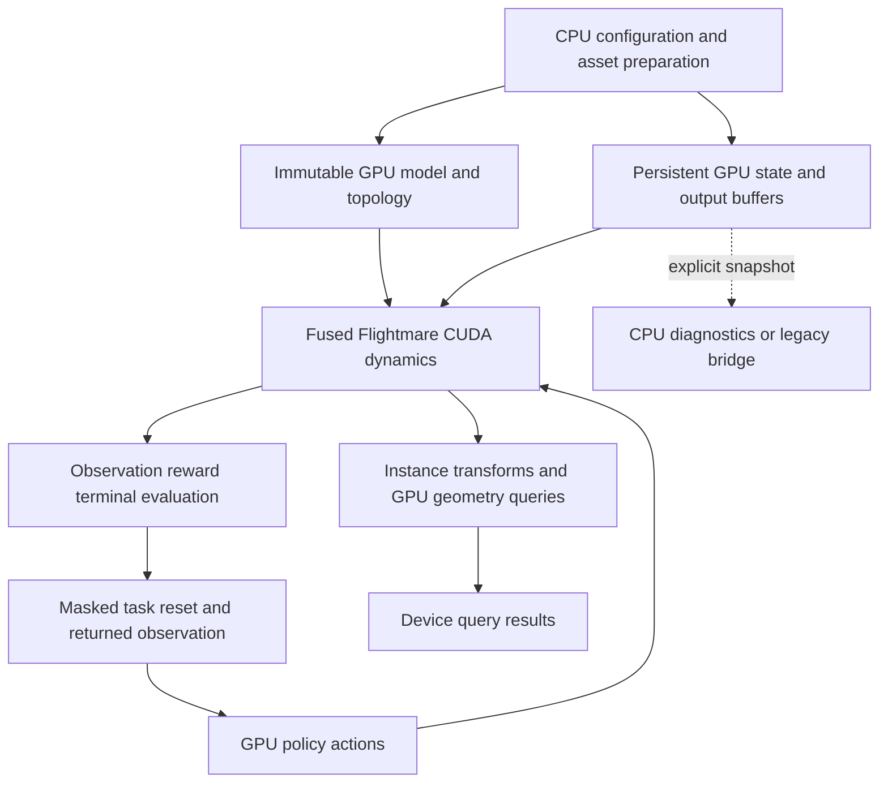

# Flightlib CUDA contracts and implementation architecture

Status: version 1 data contract frozen for implementation. Kernel partitioning
below is the initial design and may change through profiling without changing
the contract. The package currently implements descriptors and contract tests;
it does not yet allocate a simulation, integrate dynamics, or execute queries.

The authoritative declarations are
[contracts.hpp](../include/flightlib_cuda/contracts.hpp). This document defines
their semantics. Changes to field meaning, dtype, tensor shape, indexing,
ordering, or lifecycle require a new contract version and migration notes.
These C++ structures are not an on-disk or cross-compiler binary ABI. Raw
descriptors contain pointers and must never be serialized.

## Scope and architecture

Preserve Flightmare's scoped quadrotor dynamics, controller, motor model,
integrator, environment behavior, and legacy quirks. There is no PhysX or
replacement physics engine. Geometry queries report results; they do not apply
impulses or replace the legacy world-box operation. Sensors/rendering and new
platform dynamics are separate extensions, not implicit functionality in v1.

CPU work is configuration, shape validation, parameter preparation, resource
creation, and asynchronous launch orchestration. Device memory is authoritative
after upload. A future Simulation owner holds allocations and streams;
descriptors are cheap non-owning views, not per-drone objects. No Eigen, Torch,
Warp, CUDA runtime, or renderer dependency is required to include the contracts.

## Dimensions and indexing

| Symbol | Meaning |
| --- | --- |
| E | Positive environment capacity |
| A | Positive quadrotor slots per environment |
| N | E times A; lane n = e times A + a |
| P | Positive model/parameter table capacity |
| S | Number of integration substeps for one control interval |
| I | Geometry instance capacity |
| Q | Ray query capacity |
| K | Broad-phase candidate capacity per environment |

N must be below UINT32_MAX, which is the invalid index sentinel. All element
offsets, products, and byte calculations use 64-bit arithmetic, with allocation
overflow checked before allocation. Slots remain stable for the lifetime of a
simulation. An inactive slot is retained, never compacted or renumbered.
Different dynamics models will get separate typed pools; v1 is a quadrotor pool
and does not claim to simulate arbitrary platforms.

TensorView is dense row-major without hidden padding. Every descriptor's shape
must match this document. An API wrapper must validate dimensions, device,
capacity, aliasing, and dtype before enqueueing any mutations. Descriptors do
not validate these properties themselves. Device kernels do not bounds-check
each element; they must guard the lane/query index at their entry.

Internal physics is component-major [C,N]. Logical [E,A,C] access has element
strides [A,1,N]; this is an external strided alias, not a dense TensorView.
Policy input/output is dense [E,A,C], strides [A*C,C,1]. Construct observations
directly in that layout. Packing an entire state each step is forbidden unless
explicitly requested by a consumer and included in the performance budget.

For A=1 the compatibility adapter can squeeze the slot dimension without a
copy. For A>1 v1 supplies independent per-platform task results. Shared reward,
environment-wide done, group reset, and inter-platform forces are not defined.
They require an explicit task extension rather than an accidental any/all
reduction. Geometry is isolated by environment ID even if coordinates overlap.

## State schema and units

All physical values are IEEE float32; masks are uint8 values 0 or 1; IDs are
uint32; episode and random counters are uint64. Coordinates are right-handed
and local to an environment's world. Gravity is along negative Z in the default
Flightmare configuration. Position/linear velocity/linear acceleration are
world quantities in m, m/s, m/s squared; angular velocity and torque are body
quantities in rad/s and N m. Quaternion wxyz maps body vectors to world vectors.
Environment display offsets never enter dynamics or query coordinates.

| Buffer | Shape | Meaning |
| --- | --- | --- |
| state.x | [25,N] | Legacy state fields below |
| state.time | [N] | Simulation seconds, float32 |
| state.motor_omega | [4,N] | Rotor speed in rad/s, legacy rotor order |
| state.motor_thrust | [4,N] | Rotor force in N, same order |
| accepted command mode/time/payload | [N], [N], [4,N] | Persistent last accepted command |
| topology.model_id / active | [N] each | Model lookup and lifecycle mask |
| topology.world_bounds | [6,N] | xmin,xmax,ymin,ymax,zmin,zmax |
| diagnostics.status | [N] | Status of most recent submitted operation |

| state.x rows | Meaning |
| --- | --- |
| 0..2 | Position xyz |
| 3..6 | Quaternion wxyz |
| 7..9 | World linear velocity xyz |
| 10..12 | Body angular velocity xyz |
| 13..15 | World linear acceleration xyz |
| 16..18 | Body torque xyz |
| 19..21 | Legacy angular bias xyz |
| 22..24 | Legacy acceleration bias xyz |

The single [25,N] allocation is a structure of arrays: row groups are views,
not copies. Preserve auxiliary fields even where derivatives are zero. Do not
silently normalize state during import or reset. A supplied valid legacy state
need not have unit quaternion norm. Rotor state resets to zero even though the
model's commanded motor-speed lower bound is positive.

CommandMode RotorThrust payload is [f0,f1,f2,f3] in N.
CollectiveBodyRates payload is [collective,wx,wy,wz], where collective is
mass-normalized acceleration in m/s squared. Mode and all active payload values
and time must be valid. A legacy adapter must perform the original XOR validity
check on the NaN-based command fields before constructing this typed command;
it must reject ambiguous commands rather than choose a mode. Accepted commands
are clamped in the legacy order and retained until replaced. Command time and
simulation time are independent.

## Model and task parameters

QuadModelView stores SoA columns indexed by model_id. A shared model has one
column; per-lane randomization can use P=N. Inertia and its inverse are diagonal
[3,P]. Allocation/inverse allocation are [16,P], flattened row-major. Thrust
polynomial coefficients are quadratic, linear, constant. Every remaining shape
is declared in the header. Derive these values on the host using the legacy
configuration behavior, then upload. In particular preserve the cached legacy
thrust cap when YAML changes motor-speed limits; do not recompute it as a fix.
The actual prepared table is the contract, not a new parameter derivation model.

Parameters and topology are immutable during a submitted step. Updates occur
at an explicit stream-ordered boundary, with dependent constants prepared
together. World bounds are per lane. No per-lane heap allocations or matrix
inversions are allowed in the stepping path.

Task action_mean/scale are [4,N], goal is [12,N], reward coefficients are [5,N]
in position, orientation, velocity, rates, raw-action order. The legacy task
uses survival reward +0.1, terminal altitude <=0.02, terminal adjustment -0.02,
and raw action L2 norm rather than squared norm. max_t is compatibility metadata
for episode-length reporting; it does not automatically terminate this task.

| Task buffer | Shape | Semantics |
| --- | --- | --- |
| input.action | [E,A,4] | Raw actions, not clipped policy outputs |
| output.observation | [E,A,12] | Returned observation; reset observation if done |
| output.transition_observation | [E,A,12] | Post-step observation before reset, every lane |
| output.reward | [E,A] | Transition reward including terminal adjustment |
| output.done | [E,A] | Terminal flag before reset |
| output.valid | [E,A] | Whether this transition may be consumed |

Observation order is position xyz, Eigen's legacy Euler angles ZYX, linear
velocity xyz, body rates xyz. Preserve Euler branch behavior, not just the
represented rotation. Transition observation always exists so reset cannot
destroy the transition needed by training. No automatic reset may overwrite
reward or done. For inactive lanes outputs are zero and valid=0. For failed
lanes outputs are zero and valid=0, with diagnostics explaining failure; this
is the tensor API's explicit failure contract, not a claim that legacy Env::step
has identical invalid-input behavior. Valid legacy inputs retain parity.

EpisodeState stores per-lane episode number, step number, RNG key/counter, and
the task's independent command clock. A successful task reset increments episode,
zeros step and command_time, resets the task command to zero rotor thrust, and
does not rewind its random counter. Initial counters start at zero; the initial
task reset starts episode 1. Low-level Quadrotor reset restores supplied x/time
and zeros motors; it does not change the accepted command or task counters.
Invalid resets leave state and motors unchanged. A low-level state setter will
be distinct from reset because setState preserves motors.

ResetInput contains explicit per-lane state/time and a selection mask. Only
selected active lanes are read. Device RNG will generate the same format for
automatic task resets. RNG algorithm and bitwise CPU RNG reproduction are not
frozen: parity uses identical explicit reset samples; production RNG must be
reproducible per lane and independent of scheduling. Requiring exact CPU random
sequences would be a separate compatibility feature.

## Ownership and synchronization

Before first use, initialize every active lane through an explicit reset. Zero
state means x=0 with quaternion w=1, time=0, and both motor arrays zero. Command
storage starts Invalid until setCommand or a task reset installs a valid command.
Inactive lanes use the same finite neutral state; kernels skip them and write
Inactive diagnostics. Task outputs and episode counters start at zero. RNG keys
are initialized from the configured seed and stable lane ID, never allocation
address. Query outputs start Inactive with the sentinels described below.
Unused candidate slots are unspecified and must never be read past count.

Zero-capacity optional geometry/query buffers may have null pointers. Required
buffers for enabled operations must be non-null even if every lane is inactive.
No step may consume a default-constructed descriptor. TensorView::size/offset
are unchecked arithmetic helpers for validated shapes; the future binding layer
must reject arbitrary overflowing external shapes before invoking them.

The Simulation owner keeps allocations alive until all queued consumers finish.
Views do not own memory. Tensor framework adapters must retain the owner and
honor producer/consumer stream events. Device pointer, dtype, shape, stride,
device ordinal, and lifetime are all part of interop validation. No adapter
may silently call contiguous(), transfer devices, or synchronize to repair input.

Use one simulation stream initially; accept an external compatible stream or
explicit event dependencies. Input buffers remain unchanged until their work
finishes. State/output views are borrowed and overwritten by subsequent steps;
rollout history needs caller-owned device storage. Concurrent steps on the same
simulation are forbidden. Read-only rendering needs an event-protected snapshot
or a double buffer so it cannot race the next state write.

State, command storage, reset input, raw actions, model tables, and outputs must
not alias each other. This is essential for masked updates and raw-action reward
parity. Component views within state.x are the intentional exception. Device
errors are reported in device status arrays without a host read during step.
Host shape errors reject the entire call before enqueueing any work.

## Kernel stages and data flow

The initial parallel unit is one lane/thread for dynamics and one ray/thread
for queries. Blocks span lanes. This is a measured starting point, not a frozen
block size or occupancy claim. The first kernels should avoid fast-math and
preserve expression ordering until differential tests establish tolerances.

| Stage | Reads | Writes | Fusion and ordering |
| --- | --- | --- | --- |
| D dynamics | State, accepted/input commands or raw actions, model, topology, schedule | State, accepted command, lane status, task command clock when applicable | Fuse command validation/clamps, controller, motor update, RK4, all substeps, world box |
| T task evaluation | Post-D state, raw actions, goals, coefficients, status | Both observations, reward, done, valid | Fuse observation, reward, terminal calculation; can fuse into D after profiling |
| R task reset | Done/valid, reset samples or RNG, active mask | Selected state/motors/commands, counters, returned observation | Runs after T; never destroys transition observation/reward/done |
| G geometry update | Post-D state, instance local transforms | World instance poses and AABBs | Before queries; reads pre-reset state |
| Q queries | Instance poses/assets, ray requests or AABBs | Ray outputs, candidate pairs, confirmed overlap flags | Separate irregular workload; no feedback to dynamics in v1 |

With queries enabled the initial order is D -> G -> Q -> T -> R. This makes
geometry results describe the completed transition, before reset. They remain
valid until the next query call. An explicit query of the returned reset state
must update geometry again; it is a separate operation. Geometry results do not
change the legacy task's reward or terminal test. With queries disabled omit G/Q.

Within D, keep mutable state and useful RK4 intermediates local to the thread.
There are no global k1/k2/k3/k4 tensors in the contract. Retain the control-step
starting position for world-box rollback. Derivatives of acceleration/torque
and bias fields remain zero; acceleration and torque are updated before each
RK4 invocation. Preserve the ineffective quaternion normalization ordering in
the original run method. World-box constraints execute once per control call,
not per substep. Time adds control_dt once per call.

StepSchedule is shared by the batch, prepared with float remaining-time
subtraction matching Quadrotor::run, including any tiny positive remainder.
Do not replace it with an integer division or idealized repeated dt. v1 accepts
finite control_dt >=0, finite positive dt_max, and S=0 for zero duration; the
zero-duration call still follows command validation and world-box semantics.
Negative or nonfinite durations are host API errors even where legacy behavior
is underspecified. Mixed schedules require separate batches in v1.

Input-validation failures leave the affected physics lane untouched. Internal
numerical failures must set status and task valid=0; they must never silently
auto-reset or be treated as ordinary done transitions. Transactional rollback
of computed nonfinite results is an implementation decision still to validate
against the oracle, not a promise of this descriptor-only release.

Record a CUDA graph over stable buffer addresses after allocation and warmup.
Masked reset launches stay in the graph even when no lanes reset. Parameter
values can change at ordered boundaries; shapes/capacities/schedule length
require revalidation and potentially graph recapture. Full graph support must
be proven for each query backend rather than assumed.

## Geometry contracts and boundaries

GeometryInstances maps immutable asset IDs to environment and optional owner
lane. An owner must be active and belong to the same environment. local_pose
is relative to its owner, or the environment world when owner_lane is invalid.
Assets are shared across environments; do not duplicate static mesh vertices
per clone. GeometryWorldState is derived scratch, never a second authoritative
physics state. Rigid instance poses do not support scale; bake scale into assets.

RayQueryInput/Output freeze a closest-hit triangle-ray interface with capacity Q.
Origins/directions must be finite, directions unit length, and max distance
finite and positive. Hits include t=0 and t=max_distance, with ties broken by
lowest instance ID then primitive ID. Use double-sided triangles and unflipped
winding-derived normals. Miss/inactive/error outputs have +inf distance, zero
normal, invalid IDs, and the corresponding status. A backend must adapt to
these semantics or report unsupported operation before launch. Degenerate
triangles must be removed/flagged during asset preparation. Invalid environment
IDs or non-sentinel invalid owner IDs are invalid input, never cross-env access.

CandidatePairs stores at most K unique canonical instance pairs per environment.
Pair order is unspecified; use count to bound reads. Both instances must be
active and in the same environment. Skip pairs with the same non-sentinel
owner and pairs with two static owners. Overflow is explicit and invalidates
the environment's collision answer; absence of stored candidates is never
interpreted as safety when overflow=1. Reset count/overflow before each query
pass. No out-of-bounds writes and no dynamic buffer growth during a step.

CollisionFlags is only the result transport. Actual overlap geometry support,
drone collision proxies, tolerances, and touching-vs-penetration policy remain
an explicit gate before implementing narrow phase. Ray queries, proximity,
sweeps, and overlap are different operations. No contact manifold, response
solver, or general-purpose collision API is implied. Asset/BVH implementation
and query library selection remain open; a device-resident library can be used
without changing these buffers. The current CPU parity oracle cannot certify
Unity collision equivalence; geometry requires independent fixtures.

## System level risks and acceptance gates

| Risk | Architectural response | Evidence required |
| --- | --- | --- |
| RK4 fusion spills registers | Keep stages local but permit splitting D | Nsight register/spill analysis and end-to-end timing |
| More kernels increase launch cost | Capture stable schedule; fuse T where beneficial | Host launch gaps and GPU timeline |
| SoA forces policy repacking | Write dense observations directly | No full-state transpose in trace |
| Invalid/reset lanes corrupt neighbors | Stable lanes, masks, single-writer ownership | Mixed-lane differential and sanitizer tests |
| Tiny remainder gets optimized away | Freeze actual float schedule | Explicit partition oracle comparisons |
| Hidden host sync for done/error | Device masks/status; explicit debug snapshots | Zero steady-state host state transfers/syncs |
| Geometry duplication consumes VRAM | Shared assets, per-instance transforms | Memory accounting vs E and I |
| Candidate explosion or truncation | Bounded buffers, explicit overflow | Dense-scene overflow fixtures |
| Query sees reset pose | Explicit pre-reset query ordering | Terminal-step geometry test |
| Random resets depend on scheduling | Per-lane key/counter, explicit parity samples | Batch partition/reordering reproducibility |
| Graph addresses go stale | Owner lifetime and topology boundaries | Recapture and interop lifetime tests |
| Multi-drone semantics leak into legacy | Per-platform outputs; A=1 legacy adapter | Distinct-action and reset-isolation tests |

Base physical state costs (25+1+4+4)*4 = 136 bytes/lane, excluding all other
buffers. Both observation tensors cost 96 bytes/lane. Model tables, commands,
task parameters, input/reset buffers, geometry, and scratch need their own
accounting. A future allocator must report each category and reject a capacity
request before partial allocation. Geometry scratch can dominate this budget.

Acceptance is end-to-end wall time for a steady-state batch, not summed isolated
kernel times. Profile small and large E, A>1, non-warp-aligned N, reset bursts,
and query-heavy scenes. Track GPU/CPU time, allocations, transfers, synchronization,
spills, and total VRAM. Set numerical tolerances per field and trajectory length;
preserve discrete validity, clamp, terminal, and reset semantics. No claimed
speedup is justified by this contract-only implementation.

## Implementation sequence

1. Implement allocation and binding validation against these shapes, initialize
   every buffer, and expose borrowed device views with ownership/stream rules.
2. Add low-level reset/setState/setCommand and fused D, then compare complete
   states/motors/times with the frozen CPU traces. Keep the CPU oracle unchanged.
3. Add T/R, explicit reset samples, legacy A=1 adapter, and differential task
   tests. Only then add device RNG and prove reset isolation/reproducibility.
4. Capture and profile the steady-state graph; compare fusion choices and
   one-thread vs cooperative mappings before committing performance defaults.
5. Implement G and closest-ray Q against fixtures. Define overlap semantics and
   supported geometry before implementing candidate/narrow-phase processing.
6. Add framework/renderer adapters with measured copy and synchronization budgets.

Contract tests currently verify layout, stable lane mapping, index overflow,
read-only access, and actual CUDA compilation/device indexing. Dynamics parity,
query correctness, allocations, interop, and performance gates become runnable
as their implementations arrive.

## Legacy source anchors

- [State indices](../../flightlib/include/flightlib/common/quad_state.hpp)
- [Command validity](../../flightlib/src/common/command.cpp)
- [Dynamics, motors, integration ordering, and world box](../../flightlib/src/objects/quadrotor.cpp)
- [Derivative equations](../../flightlib/src/dynamics/quadrotor_dynamics.cpp)
- [RK4 arithmetic](../../flightlib/src/common/integrator_rk4.cpp)
- [Task observations and reward](../../flightlib/src/envs/quadrotor_env/quadrotor_env.cpp)
- [Vector auto reset](../../flightlib/src/envs/vec_env.cpp)
- [CPU oracle and contract suite](../../flightmare-parity-tests)
