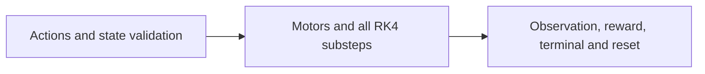

# Kernel optimization analysis — v0.1.2 baseline

The later [directed diagnostic campaign](../kernel-diagnostic-findings.md) narrows
the next implementation to shared state traversal in preparation/dynamics fusion.
Its measurements supersede the tentative experiment ordering below.

Baseline: `v0.1.2`, commit `a02e687`. Local `main` points to that commit; the
existing `master` is retained. Analysis and experiments belong on
`codex/kernel-optimization`. No simulation kernels or frozen contracts changed
for this analysis. Do not move the baseline tag to include optimizations.

## Current mapping and fusion

`N = E*A`. Thread `n = blockIdx.x*128 + threadIdx.x` owns one independent agent.
Blocks are distributed over SMs; an environment is not a serial worker. E=1,A=1000
and E=1000,A=1 have the same physical work distribution. More agents per environment
already increase parallel work. There is no inter-agent interaction in this scope.

Inside one dynamics thread, all substeps and four RK4 evaluations are fused.
Motors, forces, integration intermediates and final state stay in registers until
the control interval ends. RK4 stages depend on prior stage values, and successive
substeps depend on earlier state; those dependencies cannot be removed by adding
threads. No global RK-stage scratch or per-substep launches exist.

The environment graph has three sequential kernels:



All three kernels process the whole flattened batch. The RL wrapper adds a stats
kernel. Policy inference uses a separate Torch graph. CUDA Graphs reduce submission
overhead but do not merge kernel bodies or eliminate intermediate global-memory
accesses. [NVIDIA explains the distinction](https://developer.nvidia.com/blog/kernel-fusion-in-nvidia-cuda-optimizing-memory-traffic-and-launch-overhead/).

## Fresh scaling evidence

RTX 5070 Ti, 70 SMs, CUDA 13.3 toolchain, sm_120. Report:
`.local-ci/profile-20261117T064422.151089Z/report.json`. All 32 cases passed the
native functional and zero-allocation/copy/synchronization gates. Independent
Nsight traces at the smallest/largest cases passed with no recorded transfers,
memsets or CUDA API errors. Seven samples, 100 intervals/sample, 20 warmups,
control_dt=.01. Environment cases use 50% initial terminal/reset lanes.

| E x A | N | Dynamics us/interval | Task graph us/interval | Task throughput, million agent-steps/s |
| --- | ---: | ---: | ---: | ---: |
| 1 x 1 | 1 | 8.73 | 12.81 | 0.078 |
| 1 x 1000 | 1,000 | 8.81 | 18.85 | 53.04 |
| 1000 x 1 | 1,000 | 8.82 | 18.91 | 52.88 |
| 1024 x 16 | 16,384 | 9.93 | 25.00 | 655.24 |
| 64 x 1024 | 65,536 | 25.26 | 67.35 | 973.06 |
| 256 x 1024 | 262,144 | 89.69 | 388.64 | 674.51 |
| 1024 x 1024 | 1,048,576 | 529.24 | 1,636.02 | 640.93 |
| 4096 x 1024 | 4,194,304 | 2,088.90 | 6,442.08 | 651.08 |

These are completed amortized control intervals, not isolated latency percentiles
or RL learner throughput. Dynamics uses constant rotor commands, whereas the
task workload uses its own action/reset fixture; their difference is not a clean
measurement of added task overhead. At the largest size, dynamics throughput is
2.008 billion agent-steps/s and the arena occupies 2,311,085,312 bytes (2.15 GiB),
excluding external inputs, driver/context and RL history. The four-million-lane
case is a functional scaling probe, not a matched four-million-lane CPU differential.

Increasing N fills the device and amortizes launches, but improvement is not
unbounded: task throughput peaks in this sweep at 65,536 lanes and then plateaus
around 640–674 million. Cache working set, memory traffic and execution resources
are candidates for this transition; counter evidence is required to distinguish
them. Current hardware-counter permission remains unchanged/unavailable.

Large-batch graph trace averages per interval:

| Kernel | Time ms | Share of summed kernel time |
| --- | ---: | ---: |
| Action preparation | 1.007 | 15.6% |
| Dynamics | 2.323 | 36.1% |
| Observation/reward/reset | 3.112 | 48.3% |

Only 0.066% of the first-to-last kernel span is outside kernel intervals in that
trace; this is not achieved occupancy. At this size, more graph batching alone
cannot deliver a large win. Halving dynamics time alone would yield roughly
1.22x task-kernel speedup if the other costs were unchanged. This is an Amdahl
estimate, not an achieved result.

Fusion already helps: at 4.19M lanes, three-kernel eager stepping took 6.428 ms
versus 7.615 ms with a separate reset kernel. At N=1 those were 23.67/30.19 us.
The graph version took 6.442 ms at 4.19M and 12.81 us at N=1. Thus host launch
overhead matters strongly for small batches, while saved device work/traffic
matters at large batches. These results apply to the 50% reset fixture.

## Register pressure: measured ceiling, not achieved utilization

The new `flightmare_profile.kernel_resources` tool extracts cubins from the actual
native binary and uses CUDA Driver resource/occupancy queries, without launching
kernels or requiring hardware-counter privileges. Evidence:
`.local-ci/kernel-resources-baseline.json` and `kernel-resources-baseline.txt`.

| Kernel at 128 threads/block | Registers/thread | Blocks/SM ceiling | Warp occupancy ceiling |
| --- | ---: | ---: | ---: |
| Action preparation | 38 | 12 | 100% |
| Dynamics, either variant | 254 | 2 | 16.7% |
| Task plus reset | 90 | 5 | 41.7% |
| Task without inline reset | 48 | 10 | 83.3% |

Dynamics has eight resident warps/SM out of 48, or 256 agent threads/SM, up to
17,920 resident agent threads across this device. Larger grids execute in waves.
At the current register allocation, blocks of 32,64,128,256 all yield the same
eight-warps ceiling. A block-size-only change cannot solve this register limit,
although scheduling and tail effects can still change timing.

Dynamics reports zero stack/local storage. Task variants have a 72-byte stack
frame in cuobjdump and local bytes in the driver query, despite Nsight Systems
reporting zero local bytes in these traces. Do not equate either resource report
with measured spill traffic. The double-precision branch-cut fallback in Euler
conversion is a candidate for that stack/call cost; inspect generated code and
measure fallback frequency before attributing time to it.

Higher occupancy is not automatically faster. A prior 128-register cap introduced
spills and did not improve timing consistently; see [CUDA-4 evidence](../cuda4-performance.md).
Prefer reducing live intermediates/redundant work before imposing a register cap.
The [Blackwell resource limits](https://docs.nvidia.com/cuda/blackwell-tuning-guide/)
and [occupancy guidance](https://docs.nvidia.com/cuda/cuda-c-best-practices-guide/)
support this distinction; timing decides which candidate is retained.

## Tensor layout: retain the useful parts

- `[25,N]` state and `[4,N]` motor/command arrays suit one-thread-per-agent:
  neighboring threads access neighboring agents for each field. E/A grouping is
  a view, not a scheduling boundary. Keep this public layout initially.
- Policy actions `[E,A,4]` and observations `[E,A,12]` are dense agent rows. They
  suit Torch but component-at-a-time CUDA stores are strided across a warp.
  Evaluate vector stores or a cooperative epilogue; actual sector/DRAM efficiency
  has not been measured. A separate transpose pass could erase the gain.
- Action preparation validates all 25 state components, then dynamics loads and
  validates them again. Fusing these stages can reuse the state load and local
  command. State+time validation alone is 104 logical bytes/lane, about 416 MiB
  per 4.19M-agent interval. This is potential logical traffic reuse, not a measured
  DRAM saving. Accepted command buffers/clocks must still be materialized because
  they are observable API state.
- Six bias fields do not evolve in the current dynamics. Validate them without
  retaining them across RK4 or rewriting unchanged values, subject to exact
  zero-substep/failure semantics. Explore narrower live ranges for RK temporaries.
- Model tables already use shared model IDs. One-model runs enjoy reuse; random
  per-agent models may change cache behavior substantially. Never tune only the
  single-model case or reorder public lanes/RNG streams to group models.
- Task coefficients and reset payloads are expanded per lane. Future internal
  broadcast/model indirection could reduce capacity, but must preserve per-lane
  randomization and updates. Do not change frozen tensor ownership/views casually.

The 326-byte/lane dynamics logical budget would imply about 655 GB/s at 4.19M in
this probe, excluding model/schedule accesses. This is not a DRAM counter reading
and cannot certify bandwidth saturation. It does show why being in VRAM does not
make repeated global reads/writes free.

## Ordered experiments

1. **Specialize the environment dynamics path for rotor commands.** Task action
   preparation always produces rotor thrusts. Remove the unreachable rate-control
   branch from this compiled variant while retaining the general Core mode. Hoist
   rotor motor-target conversion outside the substep loop: desired rotor commands
   and model coefficients remain constant across that control interval. Rate-mode
   targets must still follow the changing body rates.
2. **Reduce live state and repeated model/schedule work.** Audit generated code and
   keep every rounding/order boundary. A setup-time device cache of motor decay
   per `(model, exact substep duration)` may replace repeated expf, with setup
   generation invalidation. Do not assume all float substeps have equal duration
   or replace CUDA expf with host approximations. Retain scalar arithmetic parity.
3. **Test a two-kernel task step:** fused action preparation + specialized dynamics,
   followed by fused observation/reward/reset. This removes a launch and duplicate
   loads without immediately mixing the high-register integrator with Euler/reset
   branches. Keep the original three-kernel path as the comparison/reference.
4. **Measure the task epilogue independently.** Test output-store organization,
   duplicated observations, reset density, and Euler fallback frequency. Preserve
   returned reset observations versus terminal transition observations, counters,
   reward arithmetic and branch behavior. The epilogue is nearly half the large
   fixture's kernel time; it is not incidental bookkeeping.
5. **Trial full per-agent fusion only after the above.** A one-kernel task step
   could retain state through its epilogue, but register allocation, code size,
   branch divergence and local traffic may outweigh the saved global passes.
   Register peaks across stages are not necessarily additive; measure the compiled
   result. Keep one or two whole-batch kernels rather than an RK-stage pipeline.
6. **Compose RL submission separately.** Build an opt-in capture-safe path for
   policy -> simulator -> stats/history with stable storage and explicit ordering.
   The current public runtime rejects external/nested capture; simply wrapping
   `env.step()` in a Torch graph will not work. Consider a fixed-length rollout
   graph with bounded graph size; weights update between rollouts. Graph capture
   itself will not fuse the native dynamics with cuBLAS matrix multiplies.

Separate experiments, same gates. For each candidate report raw timing against a
freshly measured baseline, registers/local storage, theoretical occupancy, launch
counts and trace evidence. Accept wall-time improvements, not occupancy increases
alone. Avoid adding shape-specific dispatch variants until repeatable measurements
justify them. No fast-math, integrator changes or relaxed parity tolerances.

## Cooperative agents and temporal batching

An entire block per agent would be a poor default for 13 integrated values. If
register-lifetime work still leaves a limit, trial a 4/8-thread tile per agent in
one fused kernel. Distribution can reduce per-thread state but introduces shuffles,
coordination, duplicated constants and a less convenient mapping for current SoA
loads. Benchmark an internal tile layout without changing public tensors first.
A whole warp per agent is an experiment, not an architectural requirement.

Shared memory is useful only for demonstrated reuse/communication or deliberate
register staging. Blindly staging independent agent state adds instructions and
capacity pressure. Likewise, persistent kernels cannot remove policy feedback
dependencies and complicate shared GPU scheduling; they are not the first change.

The dynamics kernel already batches all integration substeps. Batching multiple
control intervals inside it is valid only for an explicit open-loop/held-action
API. Closed-loop RL requires each next action to depend on the preceding observed
state. Capture that sequence with policy calls between steps rather than silently
holding actions, skipping terminal handling or changing transition history.

## RL has a different bottleneck at moderate N

The previous pinned RL trace (`rl-20261117T062532.479977Z`) has 854 total kernels
for a 32-step N=1024 collection, including 96 simulator nodes. Simulator kernels
sum to 0.545 ms; all kernels sum to 1.695 ms over a 5.810 ms kernel span. At N=16384,
those values are 0.821/3.972/7.652 ms, with 755 kernels. The remainder of the span
includes device copies, synchronization dependencies and submission gaps; it is
not all CPU idle time. No host transfers occur, but history/policy D2D copies
total 4.15/66.39 MB in those traces.

Simulation-only probes exclude neural networks. Real RL still pays for policy
inference, history and learning. Consider writing policy/history destinations
directly or a fused stats/history epilogue where ownership allows it; preserve the
pre-step observation and sampled latent/logp used by PPO. Removing PCIe traffic is
already achieved in collection, while removing unnecessary VRAM round trips and
host dispatch is the next composition opportunity. Torch graphs require fixed
addresses and retained tensors: [PyTorch CUDA semantics](https://docs.pytorch.org/docs/stable/notes/cuda.html).

## Validation matrix and reproduction

Preserve full native/CPU/core/task/usage parity, guarded arena and UBSan gates.
Include tiny/tail/large N, E/A regrouping, rotor/rate modes, mixed models, inactive
lanes, zero/remainder schedules, invalid input isolation, reset 0/50/100%, random
resets, saturated commands, Euler singularities and graph/eager equivalence.
Full-step failure semantics differ from a transaction: accepted commands may have
committed before integration fails, and physical state may advance before task
output validation fails. Fusion must reproduce those boundaries exactly.

Performance qualification should repeat representative cases and bracket GPU
timing under matched load. This initial sweep is a baseline characterization,
not an optimization acceptance test or a new CPU speedup comparison. End with
matched CPU/GPU downstream RL tests and residency traces, not physics timing alone.
The pinned sanitizer/multi-GPU coverage limits remain; no driver settings changed.

```sh
PYTHONPATH=/workspace/flightmare-profile python3 -m flightmare_profile.kernel_resources /build/flightlib-cuda-python-native/python/flightlib_cuda/_native.cpython-312-x86_64-linux-gnu.so --output /workspace/.local-ci/kernel-resources-baseline.json
PYTHONPATH=/workspace/flightmare-profile python3 -m flightmare_profile --workloads dynamics,environment,environment-split,environment-graph --cases 1x1,1x1000,1000x1,1024x16,64x1024,256x1024,1024x1024,4096x1024 --iterations 100 --samples 7 --warmup 20 --reset-percent 50 --trace
```

Run inside the existing dev container. Resource inspection currently expects all
embedded cubins to be loadable by the selected device; a multi-architecture binary
can fail explicitly instead of silently reporting resources for the wrong target.
